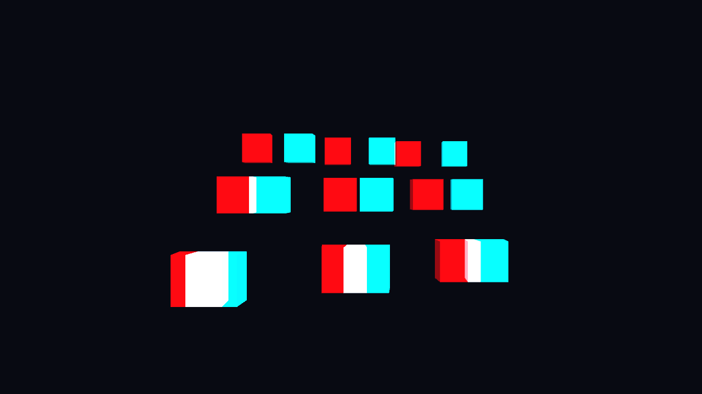

# FaceFrustrumFollower

2台のUSBカメラで顔の虹彩位置を検出し、左右の仮想カメラの位置と非対称投影を更新するUnityプロジェクトです。画面を窓として仮想空間を覗く効果を作ります。出力は赤・シアンのアナグリフです。

`frustrum_test` の試作から機能を回収し、カメラ入力・距離推定・投影・合成を分離しました。元のモデルや背景素材なしで動く、プリミティブだけのデモを同梱しています。リポジトリ名の `Frustrum` はそのまま維持しています（一般的な用語は *frustum*）。



## 起動

対象環境は **Windows x64 / Unity 6000.3.14f1**。元プロジェクトは6000.3.10f1でした。

```powershell
git clone https://github.com/testuser1111111-nd/FaceFrustrumFollower.git
cd FaceFrustrumFollower
powershell -ExecutionPolicy Bypass -File scripts/Setup-Dependencies.ps1
```

初回はMediaPipe 0.16.1の公式配布とOpenCvSharp 4.11.0.20250507をダウンロードします。MediaPipe配布は約291 MBですが、復元するのはWindows用ランタイムと顔モデルだけです。主要バイナリとモデルはSHA-256で照合します。Visual C++ 2015–2022 x64ランタイムも必要です。

1. Unity Hubでこのリポジトリのルートをプロジェクトとして開く。
2. `Assets/FaceFrustrumFollower/Demo/FaceFrustrumDemo.unity` を開く。
3. Play。初期状態は仮想の観察者が動くため、カメラを接続しなくても窓越しの視点変化を確認できます。

デモを作り直す場合は `FaceFrustrumFollower > Create demo scene` を使います。実行前のシーン編集は保存確認されます。

## 実カメラに切り替える

Playを停止し、シーン内の `FaceFrustrumFollower demo` を選びます。

- `Use Real Cameras` を有効にし、2台の `First/Second Camera Index` を設定する（初期値0と2）。
- 各カメラで測定したOpenCV XMLを `First/Second Calibration` に指定する。
- 実測したカメラ間隔を `Baseline Meters` に設定する（例: 150 mmなら0.15）。
- 物理画面の横幅・縦幅を `Screen Size Meters` に設定する。
- Playし、プレビューと追跡状態を確認する。

`calibration.example.xml` は元の1920×1080カメラから回収した参考値です。別のカメラにそのまま使える校正値ではありません。両欄に同じ例を入れた初期設定は、元の試作条件の再現用です。カメラが指定解像度を返さない場合は停止し、その理由を表示します。

距離推定は元コードの視差の大きさから求める**近似**です。カメラ間の回転・並進を測るステレオ校正、画像のステレオ平行化、ハードウェア同期は実装していません。まず同型カメラを平行に置き、既知の距離で値を確認してください。詳細は [校正と座標系](docs/CALIBRATION.md) を参照。

## 別のシーンで使う

`Assets/FaceFrustrumFollower/Runtime/Core` はOpenCV・MediaPipeに依存しません。

1. 画面中心のTransformを作り、ローカル+Zを仮想空間の奥へ向ける。スケールは1、単位はm。
2. 左右のCameraに `OffAxisCamera` を付け、画面Transformと物理サイズを指定する。
3. `StereoFaceTracker` に画面・左右のCamera Transform・校正XML・カメラ番号を指定する。別入力を使う場合はCameraの位置を直接更新してもよい。
4. 左右のRenderTextureを `TextureCombiner` に渡し、`AnaglyphCombine` Shaderと出力RenderTextureを指定する。

追跡が失われたり、視差がゼロ・距離が範囲外・フレームが古い場合は直前の位置を保持します。再び有効な結果が得られれば追従を再開します。追跡品質とカメラの向きに応じて `Invert X/Y`、`Viewer Offset Meters`、平滑化を調整できます。

## 検証とビルド

Unity Test RunnerのEditModeで `FaceFrustrumFollower.Tests` を実行します。既知の視差、無効な観測、カメラごとの内部パラメータ、画面の四隅と非対称投影、ネイティブ依存と顔モデルの読み込みを検証します。PlayModeではデモの移動と実描画を検証し、`TestResults/demo-preview.png` にプレビューを保存します。

```powershell
New-Item TestResults, work -ItemType Directory -Force | Out-Null
& 'C:/path/to/Unity.exe' -batchmode -nographics -projectPath "$PWD" -runTests -testPlatform EditMode -testFilter FaceFrustrumFollower.Tests -testResults "$PWD/TestResults/editmode.xml" -logFile "$PWD/TestResults/editmode.log"
& 'C:/path/to/Unity.exe' -batchmode -projectPath "$PWD" -runTests -testPlatform PlayMode -testFilter FaceFrustrumFollower.Tests -testResults "$PWD/TestResults/playmode.xml" -logFile "$PWD/TestResults/playmode.log"
& 'C:/path/to/Unity.exe' -batchmode -quit -projectPath "$PWD" -executeMethod FaceFrustrumFollower.Editor.ProjectTools.BuildWindows -logFile "$PWD/work/build.log"
```

移行時の検証結果と制約は [サルベージ記録](docs/SALVAGE.md) に記載しています。実機での2カメラ追跡・精度・遅延は別途確認が必要です。

## 依存とライセンス

本リポジトリのコードは既存の [Apache-2.0](LICENSE) を維持します。依存ライブラリにはそれぞれのライセンスが適用されます。[第三者依存一覧](THIRD_PARTY_NOTICES.md) を参照。

ネイティブDLL、学習済みモデル、UnityのLibraryやキャッシュはGitに入れず、セットアップで復元します。元プロジェクトのアバター、背景、アニメーション素材、NuGetエディタ拡張は同梱しません。元の4スクリプトは [docs/legacy](docs/legacy) にUTF-8の参照用テキストとして保存しています。
